<div align="center">

# Lingua Connect

### _Bridging Languages, Connecting Cultures_

[](https://github.com/Sagargupta16/Lingua-Connect/actions/workflows/ci.yml)

[](LICENSE)
[](https://nodejs.org/)
[](https://react.dev/)
[](https://mongodb.com/)

</div>

> Note: this is a sample/reference project built at the TriNIT hackathon (team BugBiters). It is not actively deployed; the Render demo linked below is offline. `npm run demo` runs the whole app locally against an in-memory MongoDB with seeded tutors, no setup needed.

---

## Overview

**Lingua Connect** is a marketplace that connects language learners with tutors for one-on-one lessons. Students sign up, filter tutors by language, experience and price, book an open slot and pay through Stripe Checkout. Tutors publish their availability as slots, write tests for their students, and students keep per-language flashcard decks.

It is a three-tier MERN app: a React 19 + Vite single-page client, an Express 5 REST API, and MongoDB through Mongoose 9.

---

## Screenshots

Captured from `npm run demo` with `npm run screenshots` (Playwright, 1440x900 desktop and iPhone 13 viewports).

| Find a tutor | Book a slot | Flashcards |
| --- | --- | --- |
| 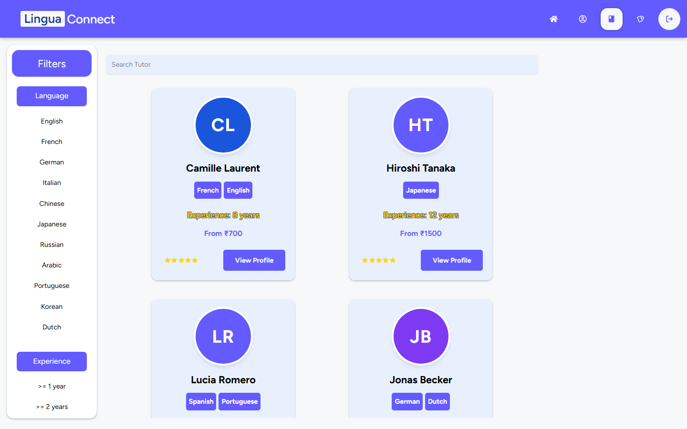 | 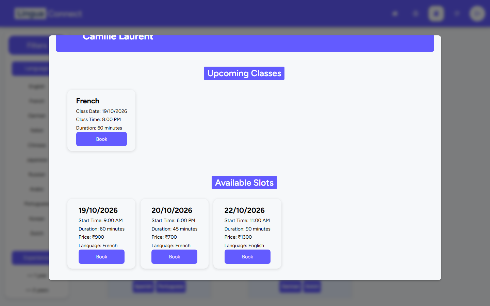 | 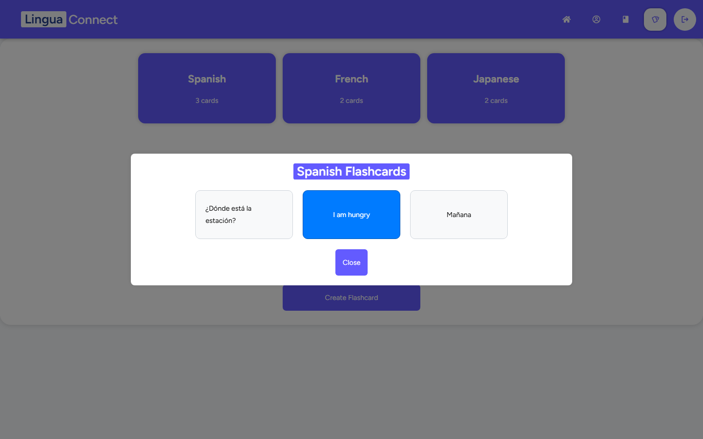 |

| Student profile | Tutor dashboard |
| --- | --- |
| 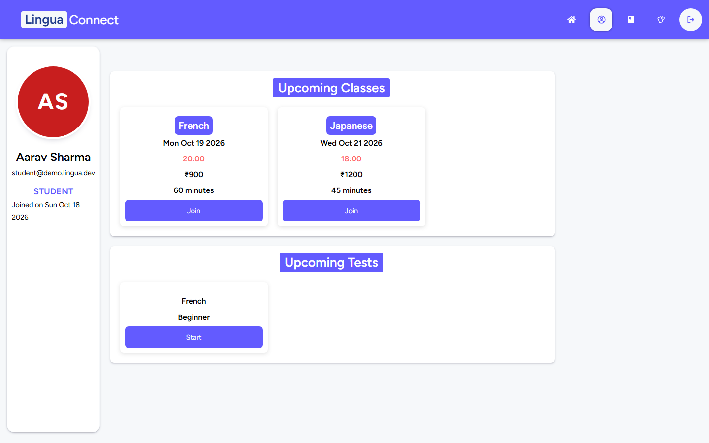 | 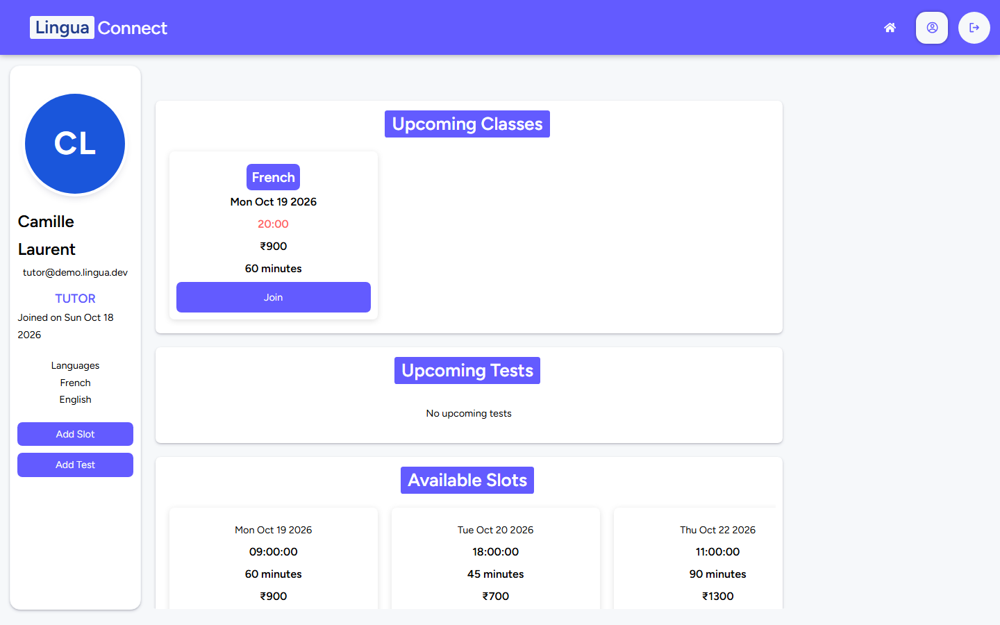 |

On a phone the filter column collapses behind a toggle, cards go full width and slot lists scroll sideways:

<p align="center">
  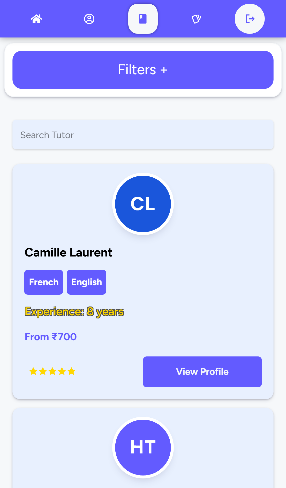
  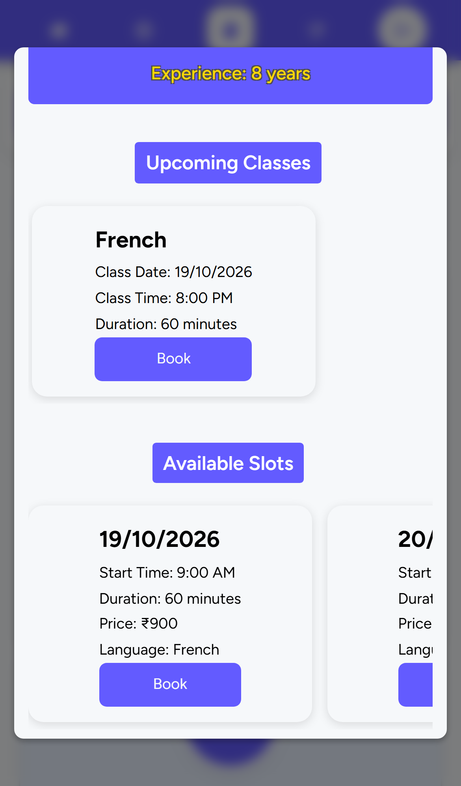
  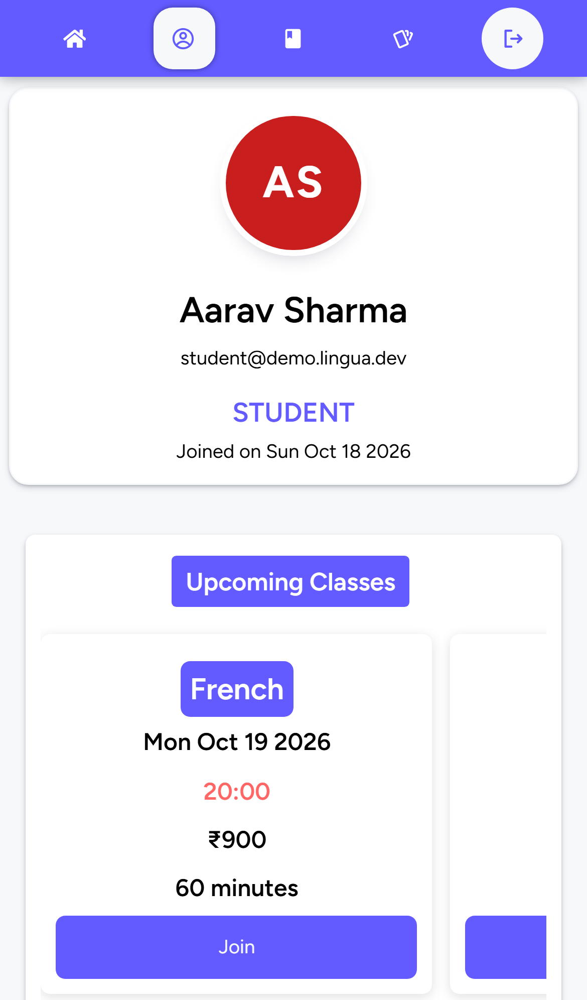
  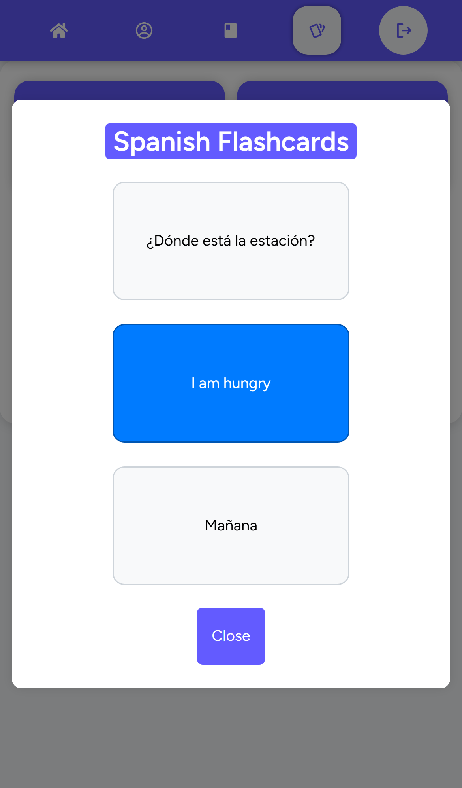
</p>

---

## Key Features

### For Students

| Feature                   | Description                                                                  |
| ------------------------- | ---------------------------------------------------------------------------- |
| **Sign up and sign in**   | Email + password accounts (bcrypt hashes, 7-day JWT), student or tutor role  |
| **Password reset by OTP** | 6-digit code mailed via Nodemailer, valid for 10 minutes                     |
| **Tutor search**          | Filter by 11 languages, years of experience and price (up to INR 5000)       |
| **Slot booking**          | Book a tutor's open slot (45, 60 or 90 minutes) and pay with Stripe Checkout; the class is booked only after Stripe confirms the payment |
| **Flashcards**            | Private decks grouped by language; tap a card to flip it                     |

### For Tutors

| Feature                | Description                                                        |
| ---------------------- | ------------------------------------------------------------------ |
| **Availability slots** | Publish date, start time, duration, price and language per slot    |
| **Class management**   | A paid slot becomes a class linked to both tutor and student       |
| **Tests**              | Create tests with question and answer pairs per language and level; only the author can edit them |

---

## Architecture

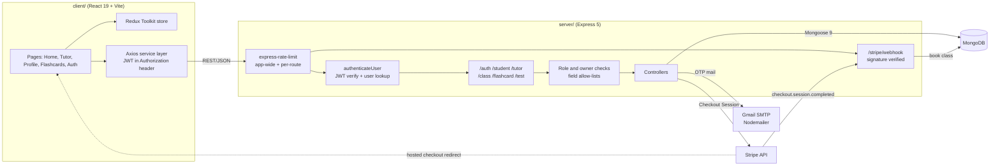

### Booking flow

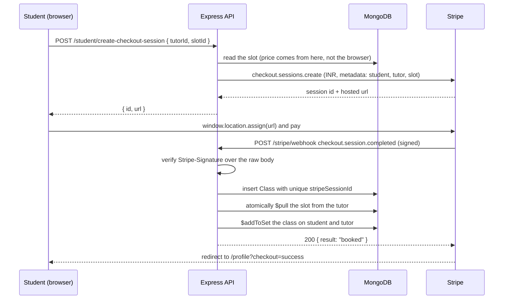

Nothing is booked until Stripe says the payment went through, so an abandoned checkout leaves the slot open. Three cases are handled and tested in [`server/test/payments.test.js`](server/test/payments.test.js):

- **Replays.** Stripe can deliver an event more than once. The Checkout Session id is a unique index on `Class`, so a second delivery answers `duplicate` and books nothing.
- **Two students, one slot.** Both can open a checkout while the slot is free. The slot is removed with a conditional `$pull`, so only one payment wins; the other class is rolled back and that payment is refunded through `stripe.refunds.create`.
- **Price tampering.** The amount is `slot.price * 100` read from MongoDB. A `price` or `quantity` in the request body is ignored.

Students can also join an existing class (`{ classId }`), which goes through the same checkout and webhook.

### Data model

| Collection  | Key fields                                                                                              |
| ----------- | ------------------------------------------------------------------------------------------------------- |
| `Student`   | name, email (unique), password hash, role, refs to classes, tests, flashcards                           |
| `Tutor`     | name, email (unique), password hash, languages, yearsOfExperience, rating, slotsAvailability[], classes |
| `Class`     | language, tutor ref, startTime, duration, price, level, isCancelled, stripeSessionId (unique, sparse)   |
| `Test`      | language, level, tutor ref (author), questions[] (question, answer)                                     |
| `Flashcard` | language, question, answer, owner ref (student)                                                         |
| `Otp`       | email, otp, createdAt (expiry checked at 10 minutes)                                                    |

Password hashes never leave the API: both user schemas strip `password` in their `toJSON` transform.

### API surface

All routes are mounted at the root (no `/api` prefix). Everything except `/auth/*` and `/stripe/webhook` needs `Authorization: Bearer <jwt>`. The full contract is in [`docs/openapi.yaml`](docs/openapi.yaml) (OpenAPI 3.1, 37 operations); `server/test/openapi.test.js` fails if a route exists in code but not in the spec, or the other way round.

| Prefix         | Endpoints                                                                                                                                   |
| -------------- | ------------------------------------------------------------------------------------------------------------------------------------------- |
| `/auth`        | `POST /signup`, `/login`, `/verify-email`, `/verify-otp`, `/reset-password`                                                                 |
| `/student`     | `GET /view`, `/view/:id`; `PUT /update/:id`; `DELETE /delete/:id`; `POST /create-checkout-session` (students only)                          |
| `/tutor`       | `GET /view`, `/view/:id`; `PUT /update/:id`; `DELETE /delete/:id`; `POST /add-slot/:id`; `DELETE /delete-slot/:id/:slotId`                  |
| `/class`       | `GET /view`, `/view/:id`; `POST /create` (tutors only); `PUT /update/:id`; `DELETE /delete/:id`                                             |
| `/flashcard`   | student role only: `GET /view`, `/view/:id`; `POST /create`, `/create/:id`, `/get/:id`; `PUT /update/:id`; `DELETE /delete/:id`             |
| `/test`        | `GET /view`, `/view/:id`; `POST /create` (tutors only), `/add-question/:id`; `PUT /update/:id`; `DELETE /delete/:id`, `/delete-question/:id/:questionId` |
| `/stripe`      | `POST /webhook`, called by Stripe and authenticated by the `Stripe-Signature` header                                                        |
| `/token-check` | `GET` returns `{ isAuthenticated: true }` for a valid token                                                                                 |

Every write is owner-checked: a student or tutor edits only their own account and slots, a tutor edits only the classes and tests they own, and a student reads and edits only their own flashcards. Anything else returns 403.

---

## Tech Decisions

- **MongoDB + Mongoose** - tutor availability is a nested array of slots per tutor, which maps naturally onto a document store; refs (`populate`) join classes, tests and flashcards back to a user.
- **Stateless JWT auth** - a 7-day token signed with `JWT_SECRET`; the middleware re-reads the user on every request so a deleted account stops working immediately.
- **Stripe Checkout (hosted page) + webhook** - no card data touches the app. The server prices the session from the database, the client redirects to `session.url` (Stripe.js removed `redirectToCheckout` in its 2025-09-30 release), and the class is created only by the signed `checkout.session.completed` webhook. The Stripe client is created on first use, so the server boots without a key and checkout answers 503 instead.
- **Two rate limiters** - a 300 requests / 5 minutes cap on every route (it runs before the JWT lookup), and a stricter 100 / 5 minutes on auth and write routes.
- **Field allow-lists and owner refs** - signup and every create or update copy only named scalar fields, so a client cannot set `role`, `password`, `rating` or an owner. `Class.tutor`, `Test.tutor` and `Flashcard.owner` are set from the JWT, never from the body, and checked on every edit.
- **Tests against a real MongoDB** - `node:test` + supertest run the actual Express app against `mongodb-memory-server`, so ownership 403s, injection 400s, webhook idempotency and the double-booking race are tested end to end, not mocked. Only the Stripe HTTP client is faked; webhook payloads are signed with Stripe's own `generateTestHeaderString`.
- **Vite over CRA** - the client moved from Create React App to Vite 8 with the Tailwind 4 plugin.

---

## Tech Stack

### Frontend

- **React 19** with **Vite 8**
- **Redux Toolkit** - state management
- **React Router 7** - client-side routing with loaders for auth gating
- **Axios** - HTTP client with a JWT request interceptor
- **Tailwind CSS 4** - utility-first CSS
- **React Icons**, **React Toastify**

### Backend

- **Node.js 24** (`.nvmrc`) and **Express 5**
- **MongoDB** with **Mongoose 9**
- **jsonwebtoken** + **bcrypt** - authentication
- **Stripe** - Checkout Sessions
- **Nodemailer** - OTP email
- **express-rate-limit**, **Winston** (logging)

### Tooling

- **GitHub Actions** - client build, server syntax check and the API test suite on every push and PR, plus CodeQL
- **node:test**, **supertest**, **mongodb-memory-server** - API tests
- **Playwright** - README screenshots (`npm run screenshots`)
- **Docker Compose** - MongoDB, API and nginx-served client in one command
- **Renovate** - dependency updates
- **Concurrently** - run client and server together
- **Prettier** - formatting

---

## Project Structure

```
Lingua-Connect/
├── client/                  # React frontend (Vite)
│   ├── index.html           # App entry HTML
│   ├── vite.config.js       # Dev server on :3000, build output in build/
│   ├── Dockerfile           # Vite build served by nginx (nginx.conf)
│   └── src/
│       ├── api/             # Axios service files, one per resource
│       ├── components/      # NavBar, auth forms, modals, filters
│       ├── pages/           # Home, Tutor, Profile, Flashcards, Auth
│       ├── store/           # Redux store and slices
│       ├── utils/           # Auth loaders and helpers
│       ├── App.jsx          # Router definition
│       └── index.jsx        # Entry point
├── server/                  # Express backend
│   ├── controllers/         # Request handlers
│   ├── middleware/          # authenticateUser, checkUserRole
│   ├── models/              # Mongoose schemas
│   ├── routes/              # Route definitions
│   ├── utils/               # Rate limiters, logger, field sanitizers, Stripe client
│   ├── scripts/             # seed.js (demo data), demo.js (in-memory MongoDB)
│   ├── test/                # node:test suites
│   ├── app.js               # Express app (no listen), used by index.js, tests and demo
│   └── index.js             # Server entry point
├── docs/
│   ├── openapi.yaml         # API contract
│   └── screenshots/         # README images
├── scripts/screenshots.mjs  # Playwright capture script
├── docker-compose.yml       # mongo + api + client
├── .github/workflows/ci.yml # CI
├── package.json             # Root scripts (concurrently)
└── README.md
```

---

## Quick Start

### Fastest: demo mode (no MongoDB, no accounts)

```bash
git clone https://github.com/Sagargupta16/Lingua-Connect.git
cd Lingua-Connect
npm run fb-install
npm run demo
```

`npm run demo` starts the API on an in-memory MongoDB seeded with 6 tutors, 11 open slots, 2 booked classes, a tutor-written test and 7 flashcards, plus the Vite client on [http://localhost:3000](http://localhost:3000). Log in as `student@demo.lingua.dev` or `tutor@demo.lingua.dev`, password `Demo1234`. Nothing is saved; stop it to reset. Checkout answers 503 unless `STRIPE_SECRET_KEY` is in `server/.env`.

### Docker Compose

```bash
docker compose up --build
```

Starts MongoDB 8, the API (seeded on first start) on :5000 and the built client on [http://localhost:3000](http://localhost:3000), with the same demo logins. Data lives in the `mongo-data` volume; `docker compose down -v` wipes it. Stripe and mail keys are read from a root `.env` if present.

### Manual setup

#### Prerequisites

- **Node.js 24** (see `.nvmrc`) and **npm 10+**
- **MongoDB** (local or Atlas)
- A Stripe test secret key and a Gmail app password, if you want checkout and OTP mail to work

#### Installation Steps

1. **Clone the repository**

   ```bash
   git clone https://github.com/Sagargupta16/Lingua-Connect.git
   cd Lingua-Connect
   ```

2. **Install all dependencies** (root, client and server)

   ```bash
   npm run fb-install
   ```

3. **Set up environment variables**

   Copy `server/.env.example` to `server/.env` and `client/.env.example` to `client/.env`, then fill in values. The server reads:

   ```env
   PORT=5000
   DB_CONNECTION_STRING=mongodb://localhost:27017/lingua-connect
   JWT_SECRET=a_long_random_string
   JWT_SALT_ROUNDS=10
   STRIPE_SECRET_KEY=sk_test_...
   STRIPE_WEBHOOK_SECRET=whsec_...
   EMAIL_ID=your_gmail_address
   EMAIL_PASSWORD=your_gmail_app_password
   CLIENT_URL=http://localhost:3000
   ```

   The client optionally reads `VITE_API_URL` to point at an API other than `http://localhost:5000`.

4. **Start the development servers**

   ```bash
   npm run start
   ```

   This runs the API with `node --watch` and the Vite dev server side by side. `npm run seed --prefix server` fills a local database with the demo data (it refuses non-local connection strings without `--force`).

   To book a class locally, forward Stripe test events to the webhook and copy the `whsec_...` it prints into `STRIPE_WEBHOOK_SECRET`:

   ```bash
   stripe listen --forward-to localhost:5000/stripe/webhook
   ```

5. **Open the application**
   - Frontend: [http://localhost:3000](http://localhost:3000)
   - Backend API: [http://localhost:5000](http://localhost:5000)

#### Alternative Commands

```bash
# Install frontend dependencies only
npm run frontend-install

# Install backend dependencies only
npm run backend-install

# Start frontend only
npm run frontend-start

# Start backend only (auto-restarts on change)
npm run backend-start

# Build the frontend for production (output in client/build)
npm run frontend-build

# Run the API tests
npm test

# Recapture the README screenshots (needs npm run demo running and
# a one-time npx playwright install chromium)
npm run screenshots
```

### Tests

`npm test` runs 29 tests in 5 files under `server/test/`: auth and injection (7), ownership and roles (7), checkout and webhook (11), the OpenAPI contract (2) and the demo seed (2). Each file starts its own in-memory MongoDB; the first run downloads the MongoDB binary.

---

## Contributing

We welcome contributions from the community! Here's how you can help:

### Development Workflow

1. **Fork the repository** to your GitHub account
2. **Create a feature branch** from `main`:
   ```bash
   git checkout -b feature-your-feature-name
   ```
3. **Implement your changes** following our coding standards
4. **Test thoroughly** to ensure no regressions
5. **Submit a pull request** with a clear description

### Branch Naming Convention

- `feature-*` for new features
- `bugfix-*` for bug fixes
- `hotfix-*` for urgent fixes

---

## License

This project is licensed under the **GNU General Public License v3.0** - see the [LICENSE](LICENSE) file for details.

---

## Development Team

Meet the talented developers behind Lingua Connect:

<table>
  <tr>
    <td align="center">
      <a href="https://github.com/Sagargupta16">
        
        <br />
        <sub><b>Sagar Gupta</b></sub>
      </a>
      <br />
      <sub>Project Lead & Full Stack Developer</sub>
    </td>
    <td align="center">
      <a href="https://github.com/sachin-gupta99">
        
        <br />
        <sub><b>Sachin Gupta</b></sub>
      </a>
      <br />
      <sub>Frontend Developer</sub>
    </td>
    <td align="center">
      <a href="https://github.com/DexTerMtor-Rahul">
        
        <br />
        <sub><b>Rahul Raj</b></sub>
      </a>
      <br />
      <sub>Backend Developer</sub>
    </td>
  </tr>
</table>

---

## Links & Resources

### Live Application

- **Production**: `https://trinit-bugbiters-dev.onrender.com` (offline - sample deployment, Render service suspended)

### Documentation & References

- [MERN Stack Guide](https://www.mongodb.com/mern-stack)
- [React Documentation](https://react.dev/)
- [Node.js Documentation](https://nodejs.org/)
- [Express.js Guide](https://expressjs.com/)
- [MongoDB Manual](https://www.mongodb.com/docs/manual/)
- [Stripe Checkout Guide](https://docs.stripe.com/payments/checkout)

### Development Tools

- [React Router](https://reactrouter.com/)
- [Axios HTTP Client](https://axios-http.com/)
- [JWT Authentication](https://jwt.io/)
- [Bcrypt Hashing](https://www.npmjs.com/package/bcrypt)
- [Mongoose ODM](https://mongoosejs.com/)
- [Nodemailer](https://nodemailer.com/)

---

<div align="center">

### 🌟 Star this repository if you found it helpful!

**Made with ❤️ by the BugBiters Team**

</div>
