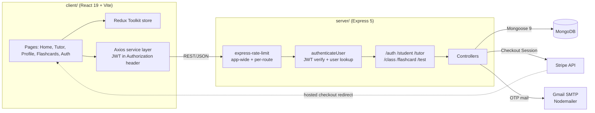
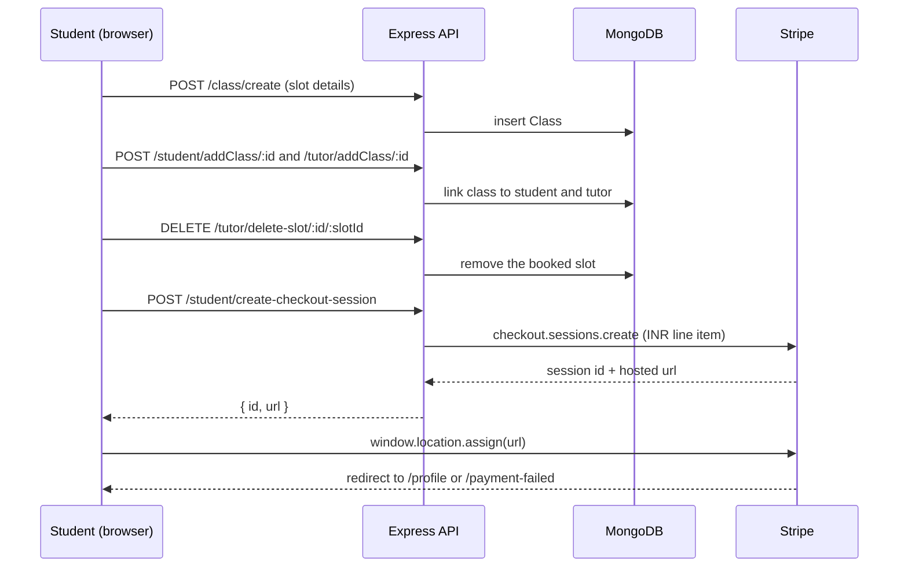

<div align="center">

# Lingua Connect

### _Bridging Languages, Connecting Cultures_

[](https://github.com/Sagargupta16/Lingua-Connect/actions/workflows/ci.yml)

[](LICENSE)
[](https://nodejs.org/)
[](https://react.dev/)
[](https://mongodb.com/)

</div>

> Note: this is a sample/reference project built at the TriNIT hackathon (team BugBiters). It is not actively deployed; the Render demo linked below is offline.

---

## Overview

**Lingua Connect** is a marketplace that connects language learners with tutors for one-on-one lessons. Students sign up, filter tutors by language, experience and price, book an open slot and pay through Stripe Checkout. Tutors publish their availability as slots, write tests for their students, and students keep per-language flashcard decks.

It is a three-tier MERN app: a React 19 + Vite single-page client, an Express 5 REST API, and MongoDB through Mongoose 9.

---

## Key Features

### For Students

| Feature                   | Description                                                                  |
| ------------------------- | ---------------------------------------------------------------------------- |
| **Sign up and sign in**   | Email + password accounts (bcrypt hashes, 7-day JWT), student or tutor role  |
| **Password reset by OTP** | 6-digit code mailed via Nodemailer, valid for 10 minutes                     |
| **Tutor search**          | Filter by 11 languages, years of experience and price (up to INR 5000)       |
| **Slot booking**          | Book a tutor's open slot (45, 60 or 90 minutes) and pay with Stripe Checkout |
| **Flashcards**            | Create and review flashcards grouped by language                             |

### For Tutors

| Feature                | Description                                                        |
| ---------------------- | ------------------------------------------------------------------ |
| **Availability slots** | Publish date, start time, duration, price and language per slot    |
| **Class management**   | A booked slot becomes a class linked to both tutor and student     |
| **Tests**              | Create tests with question and answer pairs per language and level |

---

## Architecture



### Booking flow



### Data model

| Collection  | Key fields                                                                                              |
| ----------- | ------------------------------------------------------------------------------------------------------- |
| `Student`   | name, email (unique), password hash, role, refs to classes, tests, flashcards                           |
| `Tutor`     | name, email (unique), password hash, languages, yearsOfExperience, rating, slotsAvailability[], classes |
| `Class`     | language, tutor ref, startTime, duration, price, level, isCancelled                                     |
| `Test`      | language, level, questions[] (question, answer)                                                         |
| `Flashcard` | language, question, answer                                                                              |
| `Otp`       | email, otp, createdAt (expiry checked at 10 minutes)                                                    |

Password hashes never leave the API: both user schemas strip `password` in their `toJSON` transform.

### API surface

All routes are mounted at the root (no `/api` prefix). Everything except `/auth/*` needs `Authorization: Bearer <jwt>`.

| Prefix         | Endpoints                                                                                                                                   |
| -------------- | ------------------------------------------------------------------------------------------------------------------------------------------- |
| `/auth`        | `POST /signup`, `/login`, `/verify-email`, `/verify-otp`, `/reset-password`                                                                 |
| `/student`     | `GET /view`, `/view/:id`; `PUT /update/:id`; `DELETE /delete/:id`; `POST /addClass/:id`, `/create-checkout-session`                         |
| `/tutor`       | `GET /view`, `/view/:id`; `PUT /update/:id`; `DELETE /delete/:id`; `POST /add-slot/:id`, `/addClass/:id`; `DELETE /delete-slot/:id/:slotId` |
| `/class`       | `GET /view`, `/view/:id`; `POST /create`; `PUT /update/:id`; `DELETE /delete/:id`                                                           |
| `/flashcard`   | student role only: `GET /view`, `/view/:id`; `POST /create`, `/create/:id`, `/get/:id`; `PUT /update/:id`; `DELETE /delete/:id`             |
| `/test`        | `GET /view`, `/view/:id`; `POST /create`, `/add-question/:id`; `PUT /update/:id`; `DELETE /delete/:id`, `/delete-question/:id/:questionId`  |
| `/token-check` | `GET` returns `{ isAuthenticated: true }` for a valid token                                                                                 |

---

## Tech Decisions

- **MongoDB + Mongoose** - tutor availability is a nested array of slots per tutor, which maps naturally onto a document store; refs (`populate`) join classes, tests and flashcards back to a user.
- **Stateless JWT auth** - a 7-day token signed with `JWT_SECRET`; the middleware re-reads the user on every request so a deleted account stops working immediately.
- **Stripe Checkout (hosted page)** - no card data touches the app. The server creates a Checkout Session and the client redirects to `session.url` (Stripe.js removed `redirectToCheckout` in its 2025-09-30 release).
- **Two rate limiters** - a 300 requests / 5 minutes cap on every route (it runs before the JWT lookup), and a stricter 100 / 5 minutes on auth and write routes.
- **Field allow-lists on updates** - student, tutor and test updates copy only named fields, so a client cannot set `role`, `password` or `rating`; users may only update or delete their own account.
- **Vite over CRA** - the client moved from Create React App to Vite 8 with the Tailwind 4 plugin.

---

## Tech Stack

### Frontend

- **React 19** with **Vite 8**
- **Redux Toolkit** - state management
- **React Router 7** - client-side routing with loaders for auth gating
- **Axios** - HTTP client with a JWT request interceptor
- **Tailwind CSS 4** - utility-first CSS
- **React Icons**, **React Toastify**

### Backend

- **Node.js 24** (`.nvmrc`) and **Express 5**
- **MongoDB** with **Mongoose 9**
- **jsonwebtoken** + **bcrypt** - authentication
- **Stripe** - Checkout Sessions
- **Nodemailer** - OTP email
- **express-rate-limit**, **Winston** (logging)

### Tooling

- **GitHub Actions** - client build and server syntax check on every push and PR, plus CodeQL
- **Renovate** - dependency updates
- **Concurrently** - run client and server together
- **Prettier** - formatting

---

## Project Structure

```
Lingua-Connect/
├── client/                  # React frontend (Vite)
│   ├── index.html           # App entry HTML
│   ├── vite.config.js       # Dev server on :3000, build output in build/
│   └── src/
│       ├── api/             # Axios service files, one per resource
│       ├── components/      # NavBar, auth forms, modals, filters
│       ├── pages/           # Home, Tutor, Profile, Flashcards, Auth
│       ├── store/           # Redux store and slices
│       ├── utils/           # Auth loaders and helpers
│       ├── App.jsx          # Router definition
│       └── index.jsx        # Entry point
├── server/                  # Express backend
│   ├── controllers/         # Request handlers
│   ├── middleware/          # authenticateUser, checkUserRole
│   ├── models/              # Mongoose schemas
│   ├── routes/              # Route definitions
│   ├── utils/               # Rate limiters, Winston logger
│   └── index.js             # Server entry point
├── .github/workflows/ci.yml # CI
├── package.json             # Root scripts (concurrently)
└── README.md
```

---

## Quick Start

### Prerequisites

- **Node.js 24** (see `.nvmrc`) and **npm 10+**
- **MongoDB** (local or Atlas)
- A Stripe test secret key and a Gmail app password, if you want checkout and OTP mail to work

### Installation Steps

1. **Clone the repository**

   ```bash
   git clone https://github.com/Sagargupta16/Lingua-Connect.git
   cd Lingua-Connect
   ```

2. **Install all dependencies** (root, client and server)

   ```bash
   npm run fb-install
   ```

3. **Set up environment variables**

   Copy `server/.env.example` to `server/.env` and `client/.env.example` to `client/.env`, then fill in values. The server reads:

   ```env
   PORT=5000
   DB_CONNECTION_STRING=mongodb://localhost:27017/lingua-connect
   JWT_SECRET=a_long_random_string
   JWT_SALT_ROUNDS=10
   STRIPE_SECRET_KEY=sk_test_...
   EMAIL_ID=your_gmail_address
   EMAIL_PASSWORD=your_gmail_app_password
   CLIENT_URL=http://localhost:3000
   ```

   The client optionally reads `VITE_API_URL` to point at an API other than `http://localhost:5000`.

4. **Start the development servers**

   ```bash
   npm run start
   ```

   This runs the API with `node --watch` and the Vite dev server side by side.

5. **Open the application**
   - Frontend: [http://localhost:3000](http://localhost:3000)
   - Backend API: [http://localhost:5000](http://localhost:5000)

### Alternative Commands

```bash
# Install frontend dependencies only
npm run frontend-install

# Install backend dependencies only
npm run backend-install

# Start frontend only
npm run frontend-start

# Start backend only (auto-restarts on change)
npm run backend-start

# Build the frontend for production (output in client/build)
npm run frontend-build
```

---

## Contributing

We welcome contributions from the community! Here's how you can help:

### Development Workflow

1. **Fork the repository** to your GitHub account
2. **Create a feature branch** from `main`:
   ```bash
   git checkout -b feature-your-feature-name
   ```
3. **Implement your changes** following our coding standards
4. **Test thoroughly** to ensure no regressions
5. **Submit a pull request** with a clear description

### Branch Naming Convention

- `feature-*` for new features
- `bugfix-*` for bug fixes
- `hotfix-*` for urgent fixes

---

## License

This project is licensed under the **GNU General Public License v3.0** - see the [LICENSE](LICENSE) file for details.

---

## Development Team

Meet the talented developers behind Lingua Connect:

<table>
  <tr>
    <td align="center">
      <a href="https://github.com/Sagargupta16">
        
        <br />
        <sub><b>Sagar Gupta</b></sub>
      </a>
      <br />
      <sub>Project Lead & Full Stack Developer</sub>
    </td>
    <td align="center">
      <a href="https://github.com/sachin-gupta99">
        
        <br />
        <sub><b>Sachin Gupta</b></sub>
      </a>
      <br />
      <sub>Frontend Developer</sub>
    </td>
    <td align="center">
      <a href="https://github.com/DexTerMtor-Rahul">
        
        <br />
        <sub><b>Rahul Raj</b></sub>
      </a>
      <br />
      <sub>Backend Developer</sub>
    </td>
  </tr>
</table>

---

## Links & Resources

### Live Application

- **Production**: `https://trinit-bugbiters-dev.onrender.com` (offline - sample deployment, Render service suspended)

### Documentation & References

- [MERN Stack Guide](https://www.mongodb.com/mern-stack)
- [React Documentation](https://react.dev/)
- [Node.js Documentation](https://nodejs.org/)
- [Express.js Guide](https://expressjs.com/)
- [MongoDB Manual](https://www.mongodb.com/docs/manual/)
- [Stripe Checkout Guide](https://docs.stripe.com/payments/checkout)

### Development Tools

- [React Router](https://reactrouter.com/)
- [Axios HTTP Client](https://axios-http.com/)
- [JWT Authentication](https://jwt.io/)
- [Bcrypt Hashing](https://www.npmjs.com/package/bcrypt)
- [Mongoose ODM](https://mongoosejs.com/)
- [Nodemailer](https://nodemailer.com/)

---

<div align="center">

### 🌟 Star this repository if you found it helpful!

**Made with ❤️ by the BugBiters Team**

</div>
